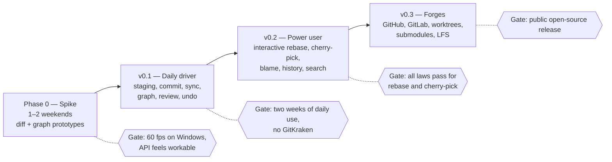

# Invoke Git — Plan

Nov 20, 2026 · Paduka Raja

What gets built in what order: a GPUI spike first, then v0.1 as a daily driver on Windows. Scope and reasoning live in the PRD; how each part works lives in the Spec.

## Milestones

Four phases, Windows only, each closed by a gate you can check; no dates are set yet, so the phases are not to scale.

A failed gate means the phase continues, not that the next one starts with debt.

## Development setup

- Write code on a Linux VPS (2 vCPU, 4 GB RAM) and push it to GitHub.
- On the VPS, build and test only non-UI crates with `cargo test --workspace --exclude ui --exclude app --exclude spike-diff --exclude spike-graph`. Never build GPUI there.
- Build, run and judge the UI on the Windows laptop. Run `git pull`, then `cargo run --release`. Install Rust with the MSVC toolchain and Visual Studio Build Tools.
- CI on a Windows runner builds and tests everything on every push.
- Phase 0 and UI tasks are laptop-heavy. Core tasks are VPS-friendly.

## Phase 0 — GPUI spike

The spike answers one question in 1–2 weekends: can GPUI render a huge diff and a huge commit graph at full frame rate on Windows, with an API you can live with?

**Setup**

1. Create the Cargo workspace with two crates: `spike-diff` and `spike-graph` (throwaway; nothing here ships).
2. Pin GPUI to one Zed commit as a git dependency in `Cargo.toml`. Once both release-build windows open on Windows, record the commit and the reason for choosing it in `README.md`.
3. Prepare a generated 50k-line file and a modified copy (≈ 2k changed lines spread across it). Use your own Linux kernel clone for the graph gate and record its commit hash in `docs/spike-results.md`. A large work repo is optional and outside the gate.
4. Write the commit-graph file in the kernel clone (`git commit-graph write --reachable`). Start the graph walk from `HEAD` only.

**Prototype A — diff view**

- Load both 50k-line files, compute a line diff (any quick crate is fine here; the real engine comes later)
- Render split view in a virtualized list with line numbers and add/remove colouring
- Parse both full files with tree-sitter in the background using the Rust grammar, then style only visible lines, following [the diff engine spec](spec/diff-engine.md#highlighting-pipeline).
- Use a temporary palette from [design/tokens.json](design/tokens.json). Map keyword to `accent`, string to `add-ink`, comment to `ink-faint`, type to `lane-2`, function to `lane-7`, and number to `warning`.
- Scroll with the mouse wheel and by dragging the scrollbar end to end

**Prototype B — commit graph**

- Read commits from the kernel clone with `gix`, in pages of 5k
- Naive lane assignment (no optimisation yet) and draw lanes + dots with a custom GPUI element
- Use virtualized rows with columns for graph, subject, author, date, and short hash
- Scroll from the newest commit to 100k commits deep

### Measurement protocol

- Run release builds on the reference Windows 11 version 25H2 laptop (OS build 26200.9974) with an Intel Core i5-12500H, 16 GB RAM, and Intel Iris Xe integrated graphics. Plug it in and close other heavy apps.
- Measure the gate at 60 Hz. Also record results at 90 Hz for information.
- For each prototype, scroll with the mouse wheel for 10 seconds and drag the scrollbar from top to bottom three times.
- At 60 Hz, the 95th-percentile frame time must be ≤ 16.7 ms, and no single frame may exceed 50 ms.
- Have the renderer count visible rows painted without their data. The count must be zero for the whole run.
- Measure first paint from data ready (both files loaded or the first commit page ready) to the first presented frame with content. The budget is 100 ms.
- Check that Microsoft Japanese or Pinyin IME composes inline and commits correctly. Verify Shift+arrow keys, mouse-drag selection, double-click to select a word, Ctrl+A, copy and paste.
- Record peak memory from Task Manager and note what was hard or missing in GPUI.

**Pass/fail checklist**

- [ ] Diff view scrolls at 60 fps or better, no blank rows, release build
- [ ] Graph scrolls 100k commits deep at 60 fps or better, no blank rows
- [ ] First paint under 100 ms for the diff view once files are in memory
- [ ] Text input works for a commit message box (IME and selection behave)
- [ ] Custom drawing (lanes, highlight backgrounds) was doable without forking GPUI
- [ ] The API felt workable: you would choose to keep going

### Gate rules

- Diff scroll, graph scroll, and “API felt workable” are must-pass boxes. Phase 0 ends only when all three pass.
- A failed box gets one retry. Spend one more weekend on fixes, then re-measure.
- If two or more boxes still fail after the retry, switch to Tauri + React with the same Rust core.
- First paint, text input, and custom drawing are soft checks. A single failure is logged as a risk in `docs/spike-results.md` and does not block Phase 0.

## v0.1 backlog

Twenty-six tasks take Invoke Git from an empty repo to a daily driver; rows are in dependency order, so working top to bottom never blocks.

**Early start (decided 2026-11-21):** the Phase 0 gate's manual runs are on hold, and v0.1 core work starts before the gate closes. A failed gate keeps the same Rust core (see Gate rules), so that work is safe either way.

- **May start now, on the VPS:**
  - pure tasks 3, 4, 5, 6, 8, 9, 12 and 24
  - the core (non-GPUI) halves of tasks 11, 13, 14, 15, 16, 17, 20 and 23
  - the lane layout and paging in 18
  - the `tokens` crate in 2
  - the diff and graph benchmarks in 25
- **Waits for the gate to pass:**
  - every GPUI crate and screen: task 2's component layer, tasks 7, 10, 19 and 21, and the UI halves of the mixed tasks
  - task 26
- **Status of a split task:** mark it "Core done" until its UI half lands.

| # | Task | Area | Depends on | Status |
| --- | --- | --- | --- | --- |
| 1 | Cargo workspace, CI (Windows build; core tests on Linux and macOS), license, README | Foundation | — | Done |
| 2 | Design tokens crate and component layer skeleton over GPUI | UI | 1 | Core done |
| 3 | Core types: `State`, `Event`, `Command`, `step()` skeleton | Core | 1 | Done |
| 4 | Shell: command runner, git CLI wrapper with progress and cancel | Shell | 3 | Done |
| 5 | Repo discovery and repo-state detection from `.git` | Core | 3 | Done |
| 6 | File watcher with debounce, emitting refresh events | Shell | 4 | Done |
| 7 | App window, open and init repo, repo tabs | UI | 2, 5 | Not started |
| 8 | Diff engine: Myers + histogram, hunks, word-level diff | Diff | 1 | Done |
| 9 | Syntax highlighting layer on tree-sitter | Diff | 8 | Done |
| 10 | Diff viewer: split and unified, virtualized | UI | 2, 8, 9 | Not started |
| 11 | Status tree with file, hunk and line staging | Core + UI | 5, 10 | Not started |
| 12 | Undo system: reflog and index snapshots | Core | 5 | Done |
| 13 | Discard file, hunk or lines, undoable | Core + UI | 11, 12 | Not started |
| 14 | Commit, amend, commit message editor | Core + UI | 11 | Not started |
| 15 | Branches: create, switch, rename, delete, detached HEAD | Core + UI | 5 | Not started |
| 16 | Clone with progress, cancel and in-app auth prompt (`GIT_ASKPASS`) | Shell + UI | 4 | Core done |
| 17 | Fetch, pull (merge or rebase), push with `--force-with-lease`, set upstream | Shell + UI | 4, 16 | Not started |
| 18 | Commit graph: lane layout, paging, renderer | Graph | 2 | Core done |
| 19 | Commit detail view with its diff | UI | 10, 18 | Not started |
| 20 | Stash: save (incl. untracked), apply, pop, drop | Core + UI | 5 | Core done |
| 21 | Pre-push review screen: outgoing commits, combined and per-commit diffs | UI | 10, 17 | Not started |
| 22 | Notes and annotations: SQLite store, anchoring, to-do warning on push | Core + UI | 21 | Not started |
| 23 | Conflict resolution UI with continue and abort | Core + UI | 10, 17 | Not started |
| 24 | Laws as `proptest` tests and the model-based test harness, in CI | Verification | 3, 11, 12 | Not started |
| 25 | Benchmarks with performance budgets, failing CI on regression | Verification | 10, 11, 18 | Not started |
| 26 | Two-week dogfood: all git work in Invoke Git (the v0.1 gate) | Release | 1–25 | Not started |

## After v0.1

The next two releases get their own backlog tables once v0.1 ships; until then this is the outline.

**v0.2 — Power user** (gate: all laws pass under model-based tests for rebase and cherry-pick)

- Interactive rebase editor: reorder by drag, squash, fixup, edit, drop
- Cherry-pick and revert, with the conflict flow from v0.1
- Tags: create, push, delete
- Blame and file history
- Commit search by message, author, hash and path
- Reflog view

**v0.3 — Forges and advanced repos** (gate: public open-source release)

- GitHub, GitLab and self-hosted GitLab accounts; clone from a repo list
- List and check out PRs/MRs; create a PR/MR from the current branch
- Worktrees, submodules, Git LFS
- Bundled MinGit fallback on Windows
