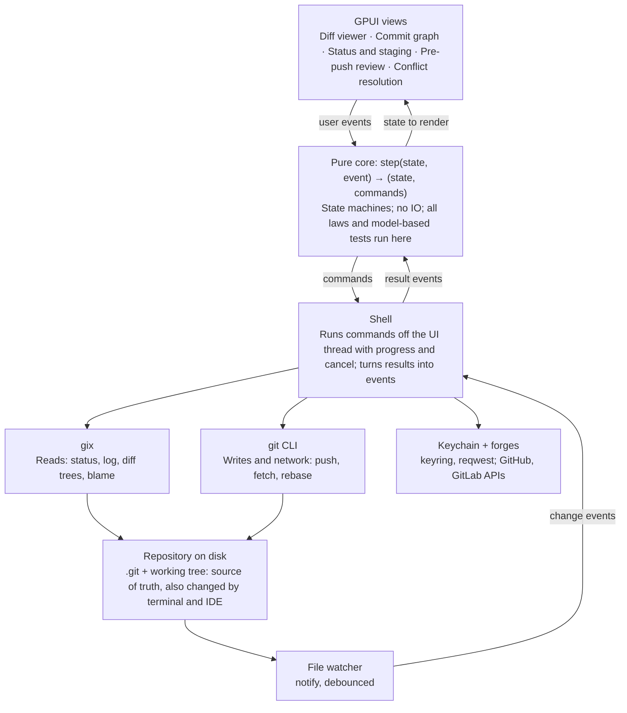
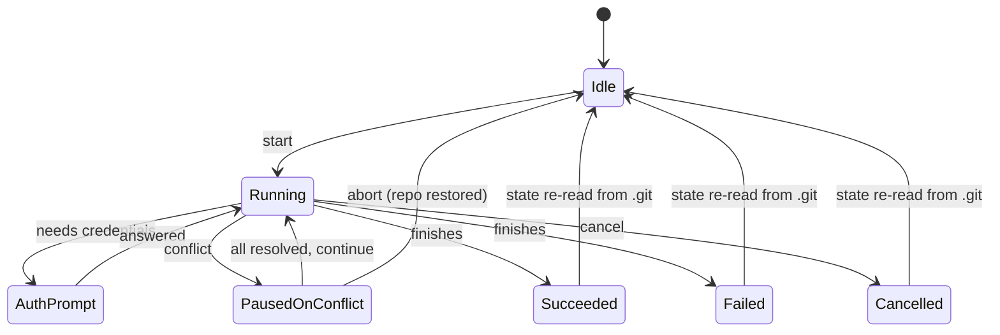

# Invoke Git — PRD

Nov 20, 2026 · Paduka Raja

## Overview

Invoke Git is a fast, native desktop git client: everything you need from GitKraken, none of the bloat, and a first-class review step before every push.

It is the second tool in the Invoke developer suite, after Invoke (API platform) and before a planned database tool. It is open source from day one, with the option to sell a paid tier later, the same model as Invoke.

**Why it exists:** existing clients are either slow and bloated (GitKraken, Electron) or fast but with a UI/UX that does not fit (Fork, Sublime Merge). Invoke Git competes on speed *and* craft: Linear-level polish on a GPU-rendered Rust core.

## Goals and non-goals

**Goals**

1. **Blazing fast on any repo size**, including monorepos and repos with 1M+ commits. Speed is a feature with budgets, not a vibe (see Performance).
2. **Never lose work.** Every destructive action is undoable or explicitly confirmed; correctness is enforced by laws and model-based tests.
3. **Review before push.** Seeing exactly what leaves your machine is a core workflow, not a hidden panel.
4. **Beautiful, calm UI** that makes git state obvious at a glance.
5. **Works with your existing setup:** same credentials, hooks and config as the git CLI in your terminal.

**Non-goals (the bloat we refuse to build)**

- No account or login wall to use the app
- No cloud workspaces, team sync or telemetry-driven "insights"
- No AI features
- No Launchpad, issue boards or project-management add-ons
- No subscription required for core git features
- No code editor or IDE features (an embedded terminal may come later)
- No keyboard command palette (mouse-first; a few standard shortcuts only)

## Product principles and UI/UX

The visual reference is Linear: dense but calm, crisp type, restrained colour, motion only where it explains a change.

- **State is visible.** Branch, ahead/behind counts, in-progress operations (merge, rebase step n/m) and conflicts are always on screen, never buried in a menu.
- **Mouse-first.** Every action is reachable by clicking, dragging or a context menu. Standard shortcuts only: Ctrl/Cmd+Enter to commit, Ctrl/Cmd+Z for undo, Esc to cancel.
- **Safe by default.** Destructive actions show what will change and offer undo. Force push is always `--force-with-lease`.
- **No blocking spinners.** Long operations run in the background with progress and a cancel button; the UI stays interactive.
- **Design tokens.** Colours, spacing, type scale, radii and motion come from one tokens file owned by Invoke Git; sharing tokens with Invoke can come later.
- **Light and dark themes** from day one, both generated from the same tokens.

## Scope and phases

Four phases, each ending at a gate. v0.1 is the point where Invoke Git replaces GitKraken as a daily driver.

**Phase 0 — GPUI spike** (1–2 weekends)

- Virtualized diff view of a 50k-line file with syntax highlighting
- Scroll a 100k-commit graph rendered from a real repo
- One pinned GPUI snapshot, wrapped in a thin component layer
- *Gate:* 60 fps scroll in both on Windows, and the API feels workable. Fail → fall back to Tauri.

**v0.1 — Daily driver**

- Repos: clone (with progress and cancel), init, open, repo tabs
- Changes: status tree, file/hunk/line staging and unstaging, discard
- Commit, amend, commit message editor with subject-length hint
- Branches: create, switch, rename, delete; detached HEAD handling
- Sync: fetch, pull (merge or rebase), push with `--force-with-lease`, set upstream
- History: commit graph, commit detail with diff
- Stash: save (incl. untracked), apply, pop, drop
- Pre-push review with notes and annotations (see Diff viewer)
- Merge conflict resolution
- Undo for the last operations, built on the reflog
- *Gate:* you use it for all git work for two weeks without opening GitKraken.

**v0.2 — Power user**

- Interactive rebase editor (drag to reorder, squash, fixup, edit, drop)
- Cherry-pick, revert, tags (create, push, delete)
- Blame, file history, commit search (message, author, hash, path)
- Reflog view
- *Gate:* all laws pass under model-based tests for rebase and cherry-pick.

**v0.3 — Forges and advanced repos**

- GitHub, GitLab and self-hosted GitLab: connect account, clone from list, list/check out PRs and MRs, create PR/MR
- Worktrees, submodules, Git LFS
- *Gate:* public open-source release.

**Later**

- Commit signing UI (GPG/SSH), partial and sparse clone, bisect, hooks viewer, embedded terminal panel
- Paid tier: discussed after v1.0; core git features stay free

## Diff viewer and pre-push review

The diff viewer is built from scratch and is the product's centrepiece; diffs.com (@pierre/diffs) is the quality bar for features, not a dependency.

**Diff modes** — one viewer, four sources:

| Mode | What it compares | Git equivalent |
| --- | --- | --- |
| Working changes | Working tree vs index | `git diff` |
| Staged changes | Index vs HEAD | `git diff --cached` |
| Outgoing, combined | Everything you are about to push | `git diff @{u}...HEAD` |
| Outgoing, per commit | Each unpushed commit on its own | `git log -p @{u}..HEAD` |

**Viewer features**

- Split (side by side) and unified layouts, switchable per session
- Word- and character-level inline highlighting inside changed lines
- Syntax highlighting via tree-sitter, computed in Rust
- Collapsed unchanged regions with expand up/down/all
- Line wrapping toggle, line numbers toggle, whitespace-ignore toggle
- File tree of changed files with +/- counts and "viewed" checkmarks
- Binary, generated (lockfiles, minified) and very large files collapsed by default
- Line selection by click, drag and Shift+click

**Staging from the diff**

- Stage or unstage a whole file, a hunk, or any selection of lines, in both layouts
- Discard a hunk or selected lines (undoable)

**Review, notes and annotations**

- Add a note on any line or range, in any mode, including outgoing review
- Notes are local and private, stored per repo and anchored to commit + file + line, so they survive rebases where possible
- A note can be marked as a to-do; push shows a warning when unresolved to-dos remain
- Pre-push review is a dedicated screen: outgoing commits list, combined diff, per-commit diffs, viewed checkmarks, then Push

**Conflict resolution**

- Conflicted files show current vs incoming blocks with Accept current / Accept incoming / Accept both per block
- Live preview of the resolved file, editable before marking resolved
- The operation (merge, rebase, cherry-pick) can only continue once every file is resolved

## Architecture and tech stack

Rust end to end: a GPUI front end renders state from a pure core, and a thin shell does all IO through gix and the git CLI.

Events take one path: the UI sends events, the core returns new state plus commands, and the shell runs the commands and feeds results back as events. Because the core does no IO, it is tested with a fake shell.

| Layer | Choice |
| --- | --- |
| UI | GPUI (one pinned snapshot) + own component layer |
| Core | Rust, pure `step(state, event) -> (state, commands)` (Model Functional Effect pattern) |
| Shell | Rust, GPUI executors for background work |
| Git reads | `gix` |
| Git writes, network, hooks | System git CLI via subprocess |
| Diff | Own Myers + histogram implementation |
| Highlighting | tree-sitter + own theming layer |
| File watching | `notify` |
| Credentials | `keyring` + `GIT_ASKPASS` helper |
| Forge APIs | `reqwest` |
| Design tokens | Invoke Git's own tokens file, generated into Rust constants |
| Repo layout | Cargo workspace: `core`, `shell`, `diff`, `graph`, `ui`, `app` crates |
| CI and release | GitHub Actions on Windows, macOS and Linux |

## Large repos and performance budgets

Large repos are a design constraint from day one: the app must stay responsive on the Linux kernel (~1.3M commits) and on a large monorepo with 100k+ files.

**Techniques**

- **Graph:** read git's commit-graph file (offer to generate it when missing); walk commits in pages; compute lanes incrementally in Rust; render only visible rows.
- **Status:** parallel status via gix; respect fsmonitor and the untracked cache; a file watcher (`notify`) with debounce triggers incremental refresh instead of full rescans.
- **Diffs:** computed per file on demand, never for the whole commit up front; highlighting only for visible lines plus a buffer; huge, binary and generated files collapsed.
- **Concurrency:** all git work off the UI thread; every operation cancellable and reporting progress.
- **Memory:** no full-history loads; caches are bounded and keyed by object id.

**Budgets (targets, measured on a mid-range Windows laptop)**

| Scenario | Budget |
| --- | --- |
| Open a repo to first paint | < 100 ms |
| Status refresh after a file save, 100k-file repo | < 100 ms |
| Cold status, 100k-file repo | < 500 ms |
| Commit graph scroll, 1M commits | Display refresh rate (120 fps on 120 Hz), never below 60 fps, no blank rows |
| Open a 10k-line file diff | < 50 ms to first visible lines |
| Stage a hunk to UI updated | < 16 ms (within one frame) |
| Idle memory, one medium repo open | < 100 MB |

Budgets are enforced with `criterion` benchmarks in CI against fixture repos; a regression past budget fails the build.

## State machines

Every stateful flow is an explicit state machine in the pure core, and repo state is always re-derived from `.git` on disk, never trusted from memory.

One lifecycle covers every long operation; merge, rebase and cherry-pick add the conflict pause, network operations add the auth prompt.

**Repo state (derived from disk)** — states can combine, e.g. dirty and detached.

| State | Detected from | Allowed actions |
| --- | --- | --- |
| Clean | No changes, no in-progress markers | All |
| Dirty | Working tree or index differs from HEAD | Commit, stash, discard, stage |
| Merging | `MERGE_HEAD` | Resolve, continue, abort |
| Rebasing (step n/m) | `rebase-merge/` or `rebase-apply/` | Resolve, continue, skip, abort |
| Cherry-picking | `CHERRY_PICK_HEAD` | Resolve, continue, abort |
| Reverting | `REVERT_HEAD` | Resolve, continue, abort |
| Detached HEAD | `HEAD` holds a commit id, not a branch | Create branch, switch branch |
| Locked | `index.lock` held by another process | Read-only until released |

**Push flow**

1. Review: outgoing commits and combined diff; unresolved to-do notes show a warning.
2. Pushing: progress and cancel; auth prompts handled in-app.
3. Done, or rejected as non-fast-forward: offer fetch + rebase (or merge), then return to step 1 with the new outgoing set.

**Conflict resolution** — each conflicted file is Unresolved or Resolved; Continue is enabled only when every file is Resolved, and Abort is always available.

**Interactive rebase editor** — Editing plan → Running → Paused (conflict or an `edit` step) → Running → Done; Abort from any state restores the original branch.

## Laws

Laws are invariants the system must never break. Each one is an executable property test; a law without a test does not count.

**Diff and patch**

1. `apply(diff(a, b), a) == b` for any two texts a and b.
2. `diff(a, a)` is empty for any text a.
3. Line numbers in every hunk map to real lines in both the old and new file.

**Staging**

4. Staging any hunk or line selection never changes the working-tree file.
5. Staging every hunk of a file makes the index equal the working-tree file.
6. Stage then unstage the same selection returns the index to its previous state.
7. Discarding a selection changes only the selected lines.

**History and refs**

8. Undo after any operation restores every ref and the index to their exact previous values.
9. No operation moves a branch the user did not target.
10. Force push only ever runs with `--force-with-lease` against the last fetched remote value.

**State and disk**

11. The app's repo state always equals the state derived from `.git` on disk after the next watcher event.
12. The app never writes to `.git` while another process holds `index.lock`.
13. A cancelled operation leaves the repo either unchanged or in git's own resumable state (never half-written).

**Graph**

14. Every commit appears exactly once in the graph, and every parent edge points to a row below its child.

## Verification plan

Rigor matches risk: the pure core gets the heaviest checks, the UI gets the lightest.

| Tier | Tool | Applies to | When |
| --- | --- | --- | --- |
| Types | Exhaustive enums, typestate (e.g. a paused rebase cannot be pushed) | All core modules | Always |
| Laws | `proptest` | Diff, patch, staging, graph layout (laws 1–7, 14) | From v0.1 |
| Model-based tests | `proptest-state-machine`: random operation sequences run on the core and on real git, results compared | Repo state, staging, undo, rebase, cherry-pick (laws 8–13) | From v0.1; required for the v0.2 gate |
| Design model checking | Quint (or TLA+) specs, checked before coding | Concurrency: watcher refresh vs user action, background fetch vs commit, `index.lock` races | Before building each concurrent feature |
| Bounded proofs | Kani | Patch application, hunk staging, lane layout | After v0.1, only these functions |
| Performance | `criterion` benchmarks on fixture repos | Status, graph, diff | Every CI run |

**Out of scope for verification:** UI layout and styling, forge API integrations, and git's own internals. The git CLI is treated as the oracle: tests check that our model of its observable behaviour matches it.

**Fixture repos:** generated synthetic repos (deep history, wide trees, binary files, unicode paths, CRLF files, submodules) plus clones of real large repos for benchmarks. Windows-specific cases (path length, case-insensitive filesystems, CRLF) run in CI on Windows.

## Auth and forge integration

Invoke Git does not manage git credentials itself; it reuses the system's, so the app and the terminal always agree.

**Git operations (clone, fetch, pull, push)**

- Run through the git CLI, which uses the system credential helper (Git Credential Manager on Windows, Keychain on macOS, libsecret on Linux) and the system SSH agent (Windows OpenSSH agent or Pageant).
- The app registers itself as `GIT_ASKPASS` / `SSH_ASKPASS` for the spawned process, so any username, password, passphrase or host-key prompt appears as an in-app dialog.
- The app never stores git passwords or private keys.

**Forge APIs (PRs, MRs, repo lists)**

| Forge | Sign-in | Notes |
| --- | --- | --- |
| github.com | OAuth device flow | No client secret in the app |
| gitlab.com | OAuth (PKCE) or personal access token | |
| Self-hosted GitLab | Personal access token + instance URL | OAuth would need an app registered per instance |

- Tokens are stored in the OS keychain via the `keyring` crate, never in plain config files.
- Multiple accounts per forge, chosen per remote by matching host.
- Forge features are optional; every core git feature works with no account connected.

## Build vs library

Build everything that is the product; use libraries only for plumbing that would take years to rebuild.

| Area | Decision | Choice |
| --- | --- | --- |
| Diff algorithm (Myers + histogram) | Build | Own Rust implementation |
| Diff viewer, staging UI, annotations, conflict UI | Build | Own GPUI elements |
| Commit graph lane layout + renderer | Build | Own algorithm and element |
| Virtualized lists | Build | Own, on GPUI `uniform_list` where it fits |
| Design system and components | Build | Own thin layer over GPUI |
| Highlighting / theming layer | Build | Own, on top of tree-sitter |
| Undo system (reflog-based) | Build | Own |
| Forge API clients | Build | Own, on `reqwest` |
| UI framework | Library | GPUI, one pinned snapshot |
| Git object reads | Library | `gix` |
| Git writes and network | Library | System git CLI (≥ 2.40, detected at startup) |
| Language grammars | Library | tree-sitter grammars |
| File watching | Library | `notify` |
| Keychain | Library | `keyring` |
| Async runtime | Library | GPUI executors, `smol` where needed |
| Testing | Library | `proptest`, `proptest-state-machine`, `criterion`, Kani, Quint |

## Risks and mitigations

| Risk | Impact | Mitigation |
| --- | --- | --- |
| GPUI is pre-1.0 and its official crate is stale; apps depend on community snapshots or a git dependency on Zed | API breakage on every update | Pin one snapshot commit; update deliberately; isolate GPUI behind an own component layer |
| GPUI docs are thin | Slow start | Phase 0 spike; read Zed's source; keep a running notes file of patterns |
| gitoxide lacks push and some write workflows | Features blocked if built on gix alone | Hybrid engine: gix for reads, git CLI for all writes and network |
| Building the diff viewer and graph from scratch takes long | v0.1 slips | v0.1 diff viewer ships unified + split with word highlighting; extras (custom separators, themes beyond light/dark) wait |
| External tools change the repo while the app is open | Stale or wrong state, data loss | Disk is source of truth (law 11); respect `index.lock` (law 12); re-derive state on watcher events |
| Windows edge cases: long paths, CRLF, case-insensitive FS, antivirus slowing file scans | Bugs and slowness on the main platform | Windows-first CI and fixtures; Windows is the primary benchmark machine |
| Requires system git | Install friction | Detect at startup and guide the install; bundle MinGit on Windows from v0.3 as a fallback |
| Crowded space (GitButler, GitComet, GitGrove, Fork, Sublime Merge) | Hard to stand out | Compete on UI/UX polish, speed budgets and the pre-push review workflow |
| Solo project scope creep | Never ships | Phase gates; non-goals list is binding |

## Decisions

| Topic | Decision |
| --- | --- |
| Name | Invoke Git; domain and trademark checked |
| License | Recommended: Apache-2.0 with DCO sign-off on contributions; any future paid features ship as a separate closed module |
| Paid tier | Discussed after v1.0; core git features stay free |
| Git dependency | Recommended: require system git ≥ 2.40 through v0.2 with a guided install; from v0.3 bundle MinGit on Windows as a fallback, always preferring the system git when present |
| Notes storage | Recommended: app data folder, one SQLite database keyed by repo identity (root commit id + remote URL), never inside `.git`; notes anchored by commit, file, blob id and surrounding lines so they survive rebases |
| Design tokens | Invoke Git's own tokens file in this repo; no sharing with Invoke for now |
| Platforms | Windows only through v0.3; macOS and Linux builds on hold. CI still runs the core (non-UI) test suite on Linux and macOS to catch Windows-only assumptions |
